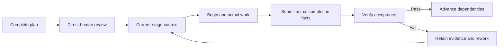

# Agent Task Harness

<a id="codex-task-harness"></a>

[English](README.md) · [简体中文](README.zh-CN.md) · [日本語](README.ja.md) · [Español](README.es.md)


**Automatically prepare a complete, reviewable Harness for complex tasks—with Codex, Claude Code or official DeepSeek Harness.**

When loaded and applicable, the host authors the complete master, substantive major stages, shared protocols, recovery instructions, deliverables, dependencies and acceptance criteria. You review that complete version before formal execution. The `draft` CLI creates a scaffold and authoring actions; it does not independently generate a substantive complete plan or approve it. Without file authorization, use a complete in-session plan. The design is based on [learn-claude-code](https://github.com/shareAI-lab/learn-claude-code), s01–s17.

Plan the complete task, obtain direct human approval, preserve execution identity and verify actual evidence. The selected host performs the work; the local runtime maintains the contract, dependencies, receipts and acceptance state.

[Getting started](docs/GETTING_STARTED.md) · [Host profiles](docs/HOSTS.md) · [Architecture](docs/ARCHITECTURE.md) · [Course mapping](docs/LEARN_CLAUDE_CODE.md) · [Validation](docs/VALIDATION.md)

[](https://github.com/Frrrrred/agent-task-harness/actions/workflows/validate.yml)
[](LICENSE)

<a id="为什么使用它"></a>
## Why use it

Complex tasks can lose their complete objective, mistake command completion for correctness, or consume downstream results after an upstream change. This skill connects the full plan, human decision, actual work and acceptance evidence. Simple questions and low-risk isolated edits can proceed directly.

| Feature | What it provides |
| --- | --- |
| Automatic complete Harness authoring | The host turns a complex request into the complete coordinated plan for direct human review |
| Complete planning and human review | The master, all major stages, shared protocols, recovery and acceptance belong to one reviewed version |
| Progressive disclosure | Resume through master and recovery, then load current-stage context and necessary dependency summaries |
| Dependency-driven progress | A task DAG with explicit output ownership; downstream work requires verified dependencies |
| Execution and acceptance separation | `begin` establishes identity, `submit` records factual completion, and `verify` checks acceptance |
| Evidence freshness | Changes to reviewed inputs affect approval; changed outputs or evidence make affected results and dependents stale |
| Original-run recovery | Preserve active run IDs, close stale work factually and replay complete identical receipts without rewriting history |
| Shared execution guards | Active or ambiguous work blocks conflicting starts and acceptance while retaining diagnostics |
| Multiple acceptance types | Artifact, command and review criteria retain failures, logs and process facts |
| Installation preview and rollback | Review exact changes, preserve existing instruction bytes and reject unsafe drift |
| Three explicit host profiles | One shared skill and engine, with native workflows and separately authorized CLI execution |
| Research evidence discipline | Sources, field mappings, parameters, dependency release decisions and negative findings remain traceable |

<a id="典型流程"></a>
## Typical workflow



Process exit alone never verifies a task. On first factual closure, eligible successful work enters `pending_acceptance`, eligible failed work enters `failed`, and ineligible work remains stale. Only current acceptance evidence establishes `verified`.

<a id="快速使用"></a>
## Quick start

Clone the repository and run its root scripts:

```powershell
git clone https://github.com/Frrrrred/agent-task-harness.git
cd agent-task-harness
npm run check:skill
npm run help
```

The core uses Node.js built-ins and bundled modules; it needs no `npm install`. Follow [Getting started](docs/GETTING_STARTED.md) to choose a host, preview exact installation targets and apply an approved plan.

| Host | Native skill entry | Usual user skill directory |
| --- | --- | --- |
| Codex | `$agent-task-harness` | `~/.agents/skills` |
| Claude Code | `/agent-task-harness` | `~/.claude/skills` |
| DeepSeek Harness | Ask the host to load `agent-task-harness`; conditional `/name` support is described in HOSTS | `<DSH home>/skills` |

Discovery depends on enabled providers and configuration. The installer accepts explicit roots; it does not install or configure an agent client. See [Host profiles](docs/HOSTS.md) for instruction files, discovery, permissions and CLI contracts.

After loading the skill, describe the task:

```text
Use agent-task-harness for this task: …
Prepare the complete master, all major stages, shared protocols,
recovery instructions and acceptance criteria for my review.
After I approve that complete version, proceed by verified dependencies.
Report actual changes, validation evidence, compatibility and unresolved issues.
```

Use the selected host's entry syntax. Prompts for continuation, acceptance failure and interrupted runs are in [Daily prompts](docs/GETTING_STARTED.md#daily-prompts).

<a id="仓库与安装边界"></a>
## Repository and installation boundary

```text
.
├── README.md / README.zh-CN.md / README.ja.md / README.es.md
├── README.en.md                Existing English links remain valid
├── docs/                       Usage, hosts, architecture, sources and validation
├── ATTRIBUTION.md / LICENSE     Attribution and licenses
├── .github/                    Windows CI and issue templates
├── skills/codex-task-harness/   Thin explicit compatibility entry
└── skills/agent-task-harness/   Canonical installable shared skill
    ├── SKILL.md
    ├── agents/openai.yaml      Codex-specific UI metadata
    ├── references/
    └── scripts/
```

**Invoke the CLI under `skills/agent-task-harness` as the skill source.** It installs the canonical source plus a generated thin sibling compatibility entry. The old entry owns no second engine, state or approvals. Calling the nested CLI selects the correct source and excludes repository documents, CI and Git metadata.

<a id="验证与使用边界"></a>
## Evidence and compatibility

- [VALIDATION](docs/VALIDATION.md) records actual counts, environment, probes and limitations. Windows CI reports remote execution separately.
- **The original 84 cross-runtime upgrade cases were not run.** Their matching external frozen baseline is unavailable. Other regressions, goldens and current-baseline checks do not replace them.
- DSH support is scoped to official commit `687f282e8625c6b8d11ff58211a90524be2e4317`, with `@deepseek-ai/dsh` `0.2.1-rc.2`. Source and strict local fixtures do not establish live DSH discovery, provider or model execution.
- No real model execution for any host is included in this validation. Existing Codex/Claude version and help probes are distinct from model runs.
- Windows / Node v26.12.1 is the established local baseline. Full tests also use Python, pwsh and filesystem link, ACL and NTFS stream capabilities. Other operating systems and a minimum Node version are not established by that evidence.
- Native work uses the selected host's available tools. Independent `run` starts a local client and requires applicable execution and model authorization.
- Host permissions differ. Runtime declarations and evidence provide neither operator authentication nor an OS sandbox or automatic scientific proof.
- Scheduling, services, MCP, compaction and complete agent teams remain host or external capabilities.

See [Compatibility](docs/COMPATIBILITY.md) for frozen templates, reviewed host selection and installation safety.


## Installation, continuation and recovery

Run from a full repository clone. Pick an existing host and replace the roots below with its actual home and skill parent; the installer does not install a client or configure a provider.

```powershell
$cli = Join-Path (Get-Location).Path 'skills/agent-task-harness/scripts/harness.mjs'
$harnessHost = 'codex'
$harnessHome = Join-Path $HOME '.codex'
$skillParent = Join-Path $HOME '.agents/skills'
$planFile = Join-Path ([IO.Path]::GetTempPath()) ('agent-task-harness-' + [guid]::NewGuid() + '.json')
node $cli install-preview --host $harnessHost --host-home $harnessHome --skill-root $skillParent --out $planFile
Get-Content -LiteralPath $planFile -Raw
```

After the user reviews and approves this exact preview, run:

```powershell
node $cli install --plan $planFile
```

Preserve the returned rollbackManifest. Review its effects before rollback:

```powershell
node $cli rollback --manifest 'ABSOLUTE_RETURNED_MANIFEST'
```

| Host ID | Home example | Skill parent | Instruction file |
| --- | --- | --- | --- |
| `codex` | `~/.codex` | `~/.agents/skills` | `AGENTS.md` |
| `claude-code` | `~/.claude` | `~/.claude/skills` | `CLAUDE.md` |
| `deepseek-harness` | `$DSH_HOME` or `~/.dsh` | `<home>/skills` | `AGENTS.md` |

New previews use **safety3** and bind both skill roles and the fixed instruction target. A recognized full old installation requires a fresh reviewed preview with **both** `--replace-skill --migrate-legacy`. Unknown files, modified old code, mixed/duplicate markers and customized blocks are refused. Separately reviewed exact custom-block changes use the explicit before/after API; the CLI never silently overwrites them.

Migration moves original old files on the same volume into bound recovery storage outside skill discovery, using numbered `.bin` slots. It retains old empty directories and their metadata. Successful rollback restores original identities, ACLs and NTFS streams, then the original safety1/2 manifest can be used again. Existing safety1/2 manifests and old previews are not rewritten. Old previews require regeneration. Reverting the old manifest before reverting the migration is rejected as drift.

A failed install/rollback can be partial. Preserve the manifest, backups, retirement storage, original cause and confirmed progress. Prepared migration manifests record completed moves and writes; an interruption before a journal confirms a new file's identity requires manual review. Only completed installations support automatic rollback. Never delete a same-hash file by guessing its identity, blindly retry, or clear a lock.

Start a new session and explicitly confirm discovery. New entries are `$agent-task-harness` (Codex), `/agent-task-harness` (Claude Code), or a request to load `agent-task-harness` in DSH with the applicable provider/consumer. Old explicit `$codex-task-harness`, `/codex-task-harness` and old documented CLI paths forward to the same canonical implementation. Codex implicit discovery is enabled only for the canonical entry. Other hosts use their own discovery.

```text
Native: context → begin → actual work and confirmed end → submit actual facts → verify
Independent CLI: context → run → inspect actual closure and receipt → verify
```

Independent `run` begins and supervises its own process and submits its facts. Do not call `begin` first or repeat normal submission. Explicit host selection uses `--host codex|claude-code|deepseek-harness` and optional `--executable LOCAL_ENTRY`; `--codex` remains a Codex-only compatibility option. It may invoke a model and needs applicable execution and resource authorization.

New-task prompt: “Use agent-task-harness to prepare the complete Harness for this task: … Present the master, all substantive stages, protocols, recovery and acceptance for my review. After my direct approval, continue by verified dependencies.”

Continuation prompt: “Resume [absolute HARNESS.md]. Read master and recovery, then context. Preserve the original approval, step, runId, host and mode; load historical evidence only for a specific gap.”

Acceptance-failure prompt: “Distinguish criterion failure, guard refusal and evidence drift. Preserve the failed attempt, arrange rework and revalidation. A refusal alone does not invalidate a current verified result.”

Recovery prompt: “Establish whether the original process actually ended. Preserve its identity and submit only real completion facts. Replay only complete identical facts; stale closure does not restore approval or acceptance.”

Eligible first `ok` closure enters `pending_acceptance`; eligible `failed` enters `failed`; ineligible original work closes factually while remaining `stale`. Only current evidence establishes `verified`. Process exit, a file or a final message alone does not prove correctness. Task schema1, template1–4 bytes, reviewed host policy, current `harness/<id>/` and legacy `.codex/harness/<id>/` locations and run/receipt identities are unchanged.

<a id="来源与致谢"></a>
## Origins

This project applies the Harness engineering principles taught in **shareAI-lab/learn-claude-code** to a shared skill and local evidence runtime. The [course mapping](docs/LEARN_CLAUDE_CODE.md) distinguishes design references, implemented behavior and host capabilities.

Required MIT notices remain with the code and reference materials. This is an independent project, not an official OpenAI, Anthropic, DeepSeek or shareAI Lab product, and does not claim to be a direct fork of the complete tutorial agent.

[Attribution](ATTRIBUTION.md) · [Contributing](CONTRIBUTING.md) · [Security reporting](SECURITY.md)

Explicit anchors preserve existing fragment links. The four complete README guides cover the same workflow; runtime instructions remain English.
