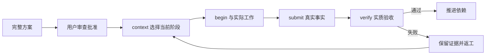

# codex-task-harness

**基于 [learn-claude-code](https://github.com/shareAI-lab/learn-claude-code) s01–s17 的 Harness 工程原则，面向 Codex 开发的复杂任务规划、执行记录与证据验收技能。**

让复杂任务有完整计划、有明确批准、有真实执行证据，并能在中断或证据失效后准确续接。Codex 负责判断和实际工作；本地运行时维护契约、依赖、运行身份和验收状态。

[English](README.en.md) · [快速开始](docs/GETTING_STARTED.md) · [架构](docs/ARCHITECTURE.md) · [教程对应](docs/LEARN_CLAUDE_CODE.md) · [验证记录](docs/VALIDATION.md)

[](https://github.com/Frrrrred/codex-task-harness/actions/workflows/validate.yml)
[](LICENSE)

## 为什么使用它

复杂任务常见的困难是：只规划第一步、把命令退出当成完成、换会话后丢失真实状态、修改上游却继续使用下游旧结果。这个技能将完整目标、依赖、批准、实际工作和最终验收连接起来，同时让简单问答和低风险单点编辑直接完成。

| 功能亮点 | 实际作用 |
| --- | --- |
| 完整规划与用户审查 | 总控、所有主要阶段、共享协议、恢复和验收共同纳入审查；正式工作等待最终用户批准 |
| 渐进加载 | 续接先读总控与恢复，再取 context；只加载当前阶段及必要依赖摘要 |
| 依赖驱动推进 | 任务组成 DAG；上游 verified 才能解锁依赖，产物有明确写入归属 |
| 执行和验收分离 | begin 记录运行身份，submit 记录真实事实，verify 检查验收标准 |
| 证据漂移传播 | 受审输入变化影响批准；产物、回执或验收证据变化使相关结果及下游 stale |
| 原运行恢复 | 保留 active runId；支持失效事实闭合、完整回执幂等重放及冲突拒绝 |
| 跨入口写入门禁 | 活动或歧义执行阻止冲突的开始和验收，保留诊断及原运行位置 |
| 多种验收与失败证据 | artifact、command、review；保留实际失败、日志、进程事实和后续恢复位置 |
| 安装预览与显式回退 | 先审查精确变更；保留个人 AGENTS 原文，对文件身份和漂移进行检查 |
| 科研与通用任务 | 记录来源、参数依据、结果链和负结果；实质正确性仍需领域验收 |

## 典型流程



进程退出本身不会验证任务。首次事实闭合时，有资格的成功结果进入 pending_acceptance，有资格的失败结果进入 failed，无资格的结果保持 stale。只有实际验收通过才是 verified；旧结果重放和事实收尾有各自规则。

## 快速使用

克隆仓库后，在仓库根运行以下脚本；脚本指向技能子目录：

```powershell
git clone https://github.com/Frrrrred/codex-task-harness.git
cd codex-task-harness
npm run check:skill
npm run help
```

核心使用 Node.js 内置模块，无需 npm install。安装使用显式目标和预览，详见[安装与日常使用](docs/GETTING_STARTED.md)。

安装后在 Codex 中直接输入：

```text
使用 $codex-task-harness 处理以下复杂任务。
先准备完整总控、主要阶段、恢复和验收，交我审查；
批准后按依赖连续推进，最后报告实际差异、验证证据和兼容影响。
任务：……
```

旧包续接、验收失败和异常恢复的可直接使用提示词见[日常场景](docs/GETTING_STARTED.md#日常提示词)。

## 仓库与安装边界

```text
.
├── README.md / README.en.md
├── docs/                       使用、架构、教程对应、兼容与验证
├── ATTRIBUTION.md / LICENSE     来源与许可
├── .github/                    Windows CI 与问题模板
└── skills/codex-task-harness/   可安装技能与必要回归资源
    ├── SKILL.md
    ├── agents/openai.yaml
    ├── references/
    └── scripts/
```

安装器会递归复制技能源。**只把 skills/codex-task-harness 作为技能源，不把仓库根作为技能源**，以免复制 Git 元数据、仓库文档或 CI。仓库介绍和开发文档位于安装目录之外。

## 验证与使用边界

- 完整主回归覆盖任务生命周期、模板兼容、异常恢复和安装回退；实际用例总数、运行环境及结果见[验证记录](docs/VALIDATION.md)，远端结果看上方 Windows CI。
- **84 项跨运行时升级回归未执行**：所需匹配的外部冻结基线当前不可用。现有金样、主回归和其他兼容检查不替代这套升级实测。
- 已验证环境以 Windows / Node v26.12.1 为基础；完整测试还使用 Python、pwsh 及 NTFS 链接、ACL 和命名流能力。其他系统与最低 Node 版本不作未经实测的保证。
- 普通路线使用当前 Codex 宿主的原生工具。独立 run 需要本机 Codex 可执行文件和适用的额外模型调用授权。
- 运行时记录批准声明和证据，不提供身份认证、OS 沙箱或自动科学正确性证明。
- 定时任务、常驻后台、MCP 服务、模型上下文压缩和完整 Agent Teams 由宿主或外部系统提供；本仓库没有把教程全部机制重新实现一遍。

详细规则见[兼容边界](docs/COMPATIBILITY.md)。

## 来源与致谢

本项目参考 **shareAI-lab/learn-claude-code** 的 Harness 工程原则，面向 Codex 开发与复核。教程章节的参考关系及宿主能力边界见[对应说明](docs/LEARN_CLAUDE_CODE.md)。

代码和参考材料的 MIT 通知随仓库保留。本项目不是 OpenAI 或 shareAI Lab 的官方产品，也不宣称是教程代码的直接 fork。[完整来源说明](ATTRIBUTION.md) · [贡献指南](CONTRIBUTING.md) · [安全报告](SECURITY.md)
