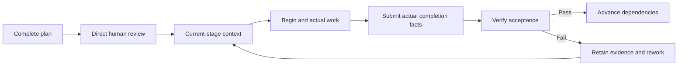

# codex-task-harness

**A shared skill and local task runtime for Codex, Claude Code and official DeepSeek Harness, developed around the Harness engineering principles taught in [learn-claude-code](https://github.com/shareAI-lab/learn-claude-code), s01–s17.**

Plan the complete task, obtain direct human approval, preserve execution identity and verify actual evidence. The selected host performs the work; the local runtime maintains the contract, dependencies, receipts and acceptance state.

[Getting started](docs/GETTING_STARTED.md) · [Host profiles](docs/HOSTS.md) · [Architecture](docs/ARCHITECTURE.md) · [Course mapping](docs/LEARN_CLAUDE_CODE.md) · [Validation](docs/VALIDATION.md)

[](https://github.com/Frrrrred/codex-task-harness/actions/workflows/validate.yml)
[](LICENSE)

<a id="为什么使用它"></a>
## Why use it

Complex tasks can lose their complete objective, mistake command completion for correctness, or consume downstream results after an upstream change. This skill connects the full plan, human decision, actual work and acceptance evidence. Simple questions and low-risk isolated edits can proceed directly.

| Feature | What it provides |
| --- | --- |
| Complete planning and human review | The master, all major stages, shared protocols, recovery and acceptance belong to one reviewed version |
| Progressive disclosure | Resume through master and recovery, then load current-stage context and necessary dependency summaries |
| Dependency-driven progress | A task DAG with explicit output ownership; downstream work requires verified dependencies |
| Execution and acceptance separation | `begin` establishes identity, `submit` records factual completion, and `verify` checks acceptance |
| Evidence freshness | Changes to reviewed inputs affect approval; changed outputs or evidence make affected results and dependents stale |
| Original-run recovery | Preserve active run IDs, close stale work factually and replay complete identical receipts without rewriting history |
| Shared execution guards | Active or ambiguous work blocks conflicting starts and acceptance while retaining diagnostics |
| Multiple acceptance types | Artifact, command and review criteria retain failures, logs and process facts |
| Installation preview and rollback | Review exact changes, preserve existing instruction bytes and reject unsafe drift |
| Three explicit host profiles | One shared skill and engine, with native workflows and separately authorized CLI execution |
| Research evidence discipline | Sources, field mappings, parameters, dependency release decisions and negative findings remain traceable |

<a id="典型流程"></a>
## Typical workflow



Process exit alone never verifies a task. On first factual closure, eligible successful work enters `pending_acceptance`, eligible failed work enters `failed`, and ineligible work remains stale. Only current acceptance evidence establishes `verified`.

<a id="快速使用"></a>
## Quick start

Clone the repository and run its root scripts:

```powershell
git clone https://github.com/Frrrrred/codex-task-harness.git
cd codex-task-harness
npm run check:skill
npm run help
```

The core uses Node.js built-ins and bundled modules; it needs no `npm install`. Follow [Getting started](docs/GETTING_STARTED.md) to choose a host, preview exact installation targets and apply an approved plan.

| Host | Native skill entry | Usual user skill directory |
| --- | --- | --- |
| Codex | `$codex-task-harness` | `~/.agents/skills` |
| Claude Code | `/codex-task-harness` | `~/.claude/skills` |
| DeepSeek Harness | Ask the host to load `codex-task-harness`; conditional `/name` support is described in HOSTS | `<DSH home>/skills` |

Discovery depends on enabled providers and configuration. The installer accepts explicit roots; it does not install or configure an agent client. See [Host profiles](docs/HOSTS.md) for instruction files, discovery, permissions and CLI contracts.

After loading the skill, describe the task:

```text
Use codex-task-harness for this task: …
Prepare the complete master, all major stages, shared protocols,
recovery instructions and acceptance criteria for my review.
After I approve that complete version, proceed by verified dependencies.
Report actual changes, validation evidence, compatibility and unresolved issues.
```

Use the selected host's entry syntax. Prompts for continuation, acceptance failure and interrupted runs are in [Daily prompts](docs/GETTING_STARTED.md#daily-prompts).

<a id="仓库与安装边界"></a>
## Repository and installation boundary

```text
.
├── README.md / README.en.md
├── docs/                       Usage, hosts, architecture, sources and validation
├── ATTRIBUTION.md / LICENSE     Attribution and licenses
├── .github/                    Windows CI and issue templates
└── skills/codex-task-harness/   Installable shared skill
    ├── SKILL.md
    ├── agents/openai.yaml      Codex-specific UI metadata
    ├── references/
    └── scripts/
```

**Use only `skills/codex-task-harness` as the skill source.** The installer copies its source recursively. Calling the nested CLI selects the correct source and excludes repository documents, CI and Git metadata.

<a id="验证与使用边界"></a>
## Evidence and compatibility

- [VALIDATION](docs/VALIDATION.md) records actual counts, environment, probes and limitations. Windows CI reports remote execution separately.
- **The original 84 cross-runtime upgrade cases were not run.** Their matching external frozen baseline is unavailable. Other regressions, goldens and current-baseline checks do not replace them.
- DSH support is scoped to official commit `687f282e8625c6b8d11ff58211a90524be2e4317`, with `@deepseek-ai/dsh` `0.2.1-rc.2`. Source and strict local fixtures do not establish live DSH discovery, provider or model execution.
- No real model execution for any host is included in this validation. Existing Codex/Claude version and help probes are distinct from model runs.
- Windows / Node v26.12.1 is the established local baseline. Full tests also use Python, pwsh and filesystem link, ACL and NTFS stream capabilities. Other operating systems and a minimum Node version are not established by that evidence.
- Native work uses the selected host's available tools. Independent `run` starts a local client and requires applicable execution and model authorization.
- Host permissions differ. Runtime declarations and evidence provide neither operator authentication nor an OS sandbox or automatic scientific proof.
- Scheduling, services, MCP, compaction and complete agent teams remain host or external capabilities.

See [Compatibility](docs/COMPATIBILITY.md) for frozen templates, reviewed host selection and installation safety.

<a id="来源与致谢"></a>
## Origins

This project applies the Harness engineering principles taught in **shareAI-lab/learn-claude-code** to a shared skill and local evidence runtime. The [course mapping](docs/LEARN_CLAUDE_CODE.md) distinguishes design references, implemented behavior and host capabilities.

Required MIT notices remain with the code and reference materials. This is an independent project, not an official OpenAI, Anthropic, DeepSeek or shareAI Lab product, and does not claim to be a direct fork of the complete tutorial agent.

[Attribution](ATTRIBUTION.md) · [Contributing](CONTRIBUTING.md) · [Security reporting](SECURITY.md)

Explicit non-English anchor IDs preserve existing fragment links; maintained prose is English.
