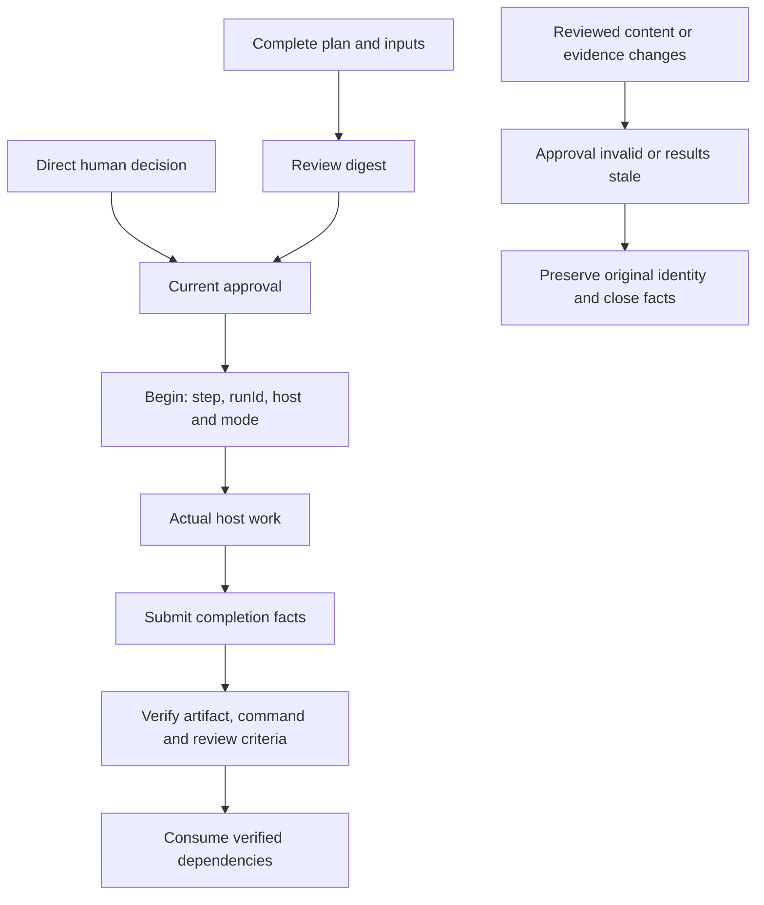

# Architecture and state

[README](../README.md) · [Host profiles](HOSTS.md) · [Runtime](../skills/codex-task-harness/references/runtime.md)

## Two layers

Repository documentation, attribution, validation and CI remain outside the installable `skills/codex-task-harness` subtree. SKILL.md routes the workflow; references load conditionally; Node built-ins and bundled modules implement the local runtime and tests.

One state/evidence engine serves three small profiles. The selected host performs actual native work. Independently authorized CLI execution uses a profile and common process supervision.

## Task packages

A layered package contains a master, complete contract, substantive phases/protocols, recovery and runtime-owned state, receipts, logs and acceptance records. Reviewed plans remain separate from execution records. Review binds the full package and declared inputs. A decision records an actual human response for its ID/revision/digest; it does not authenticate the operator.

## Reading route

For an existing layered entry, read master and recovery, then context. Load only the selected phase, applicable protocols and accepted dependency summaries. Read raw history for a specific gap. For a new task, prepare the complete package before human review. Generated files, path-check success and machine review do not establish approval or semantic correctness.

## Execution, acceptance and recovery

| Interface | Responsibility |
| --- | --- |
| begin | Check current approval, dependencies, reviewed host policy and writer guards; establish original identity |
| submit | Record facts after actual completion; does not terminate a process |
| verify | Check current outputs, receipts and artifact/command/review criteria |
| status/context | Derive current evidence state without persisting it |

First eligible ok closure enters pending_acceptance; eligible failed enters failed; ineligible closure remains stale. Acceptance establishes verified. Complete identical replay recovers receipt-publication/state-save gaps without repeating execution. Conflicts and partial finals are preserved and rejected.

Activity is separate from freshness: drift does not end a process or remove its run. Guards cover starts and all acceptance types. A process error or failed kill is not close. A guard refusal records a failed attempt but does not revoke an otherwise valid verified result; real evidence drift does. See [recovery](../skills/codex-task-harness/references/recovery-maintenance.md).

## Host and installation boundaries

Template 4 binds allowed hosts and a default. New runs bind one of six identities; original-run closure does not adopt current settings. Old templates retain Codex semantics. [HOSTS](HOSTS.md) defines discovery, argv and permission differences.

Safety2 installation binds profile, fixed instruction name, roots, content and identities. Canonical locks cover every mutation root in stable order, including a skill root shared by different homes. Preview equality, byte preservation and partial-failure diagnostics remain. Complete legacy Codex safety1 rollback is supported. Cooperating current entrypoints share these locks; quiesce older or unrelated installers that do not implement the same locking protocol.

## Artifacts and research

Each output has one owner; dependencies are acyclic. Outputs are ordinary files. Declare required loose members individually or a real archive, then verify membership/content separately. Hashes and existence do not prove meaning, scientific validity or independence.

Research requires sources and field mapping, parameter rationale, critical dependency release evidence and negative results. See the [research protocol](../skills/codex-task-harness/references/research.md).

## Compatibility interfaces

State schema, template selection, task revision and installation safety serve different purposes. Omitted/1/2/3 rendering stays frozen; new drafts use4. Old packages preserve bytes, approval and identity until an explicitly reviewed revision changes them. [Compatibility](COMPATIBILITY.md) covers upgrades, unknown-version stale closure and old installation inputs.

Non-English anchor IDs preserve old links.
