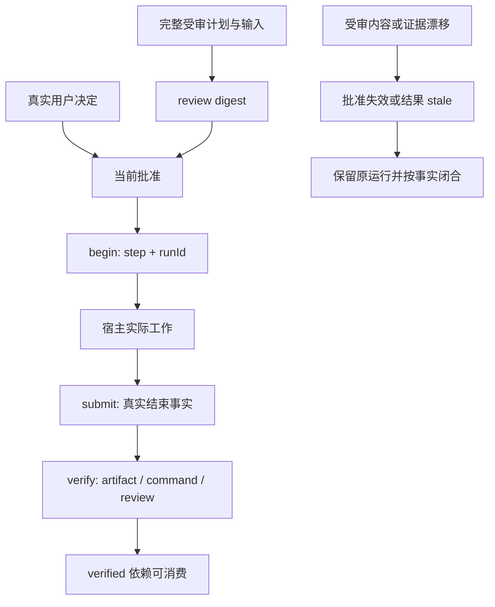

# 架构与状态

[返回 README](../README.md) · [完整运行接口](../skills/codex-task-harness/references/runtime.md)

## 两个层次

仓库根面向使用者，提供介绍、安装、测试、来源和 CI。skills/codex-task-harness 是独立可安装技能：SKILL.md 负责路由，references 按条件加载，scripts 提供本地运行时和回归。

核心仅导入 Node 内置模块及包内模块。Codex 宿主实际执行读写、命令和独立只读调查；本地运行时记录契约、身份、依赖和证据。独立 CLI run 是另一条需要适用授权的执行路线。

## 任务包

分层任务包包含 HARNESS.md、contract.json、实质阶段/共享协议、RECOVERY.md，以及运行时管理的 state、回执、日志和验收记录。

受审计划与执行记录分开。review 绑定完整计划及声明输入的当前内容；decision 记录真实用户对任务 ID、revision 和 digest 的决定。调用者声明并不认证用户身份。

## 读取路由

已有分层入口时，先读总控与恢复，随后取 context。再加载当前阶段、适用协议和已验收依赖摘要；只有具体缺口才读取历史原件。context 只读派生状态，不是一次新的批准。

新任务先准备完整方案，再交用户审查。生成文件、路径检查或机器 review 成功只表示包可审查，不能让执行器自行批准。

## 运行、验收与恢复

| 入口 | 职责 |
| --- | --- |
| begin | 通过当前批准/依赖/活动执行门禁后建立原运行身份 |
| submit | 在真实执行结束后记录事实；本身不会终止进程 |
| verify | 检查当前产物、回执和 artifact/command/review 标准 |
| status / context | 只读刷新与派生，不根据旧 state 字面值假称完成 |

首次闭合中，有资格 ok 进入 pending_acceptance，有资格 failed 进入 failed，无资格 stale 闭合不恢复批准。只有验收通过建立 verified。相同事实的完整回执重放支持发布后保存窗口恢复；冲突、部分或篡改回执拒绝并保留。

active 身份与证据新鲜度分开。上游漂移不清除原运行；不能借重审、删除状态或再次 begin 来抹掉活动工作。跨入口活动/歧义执行门禁覆盖不同验收类型。原进程未实际 close 时，错误或 kill 失败不能证明结束。

verify 的失败尝试和任务当前状态也分开。一次门禁拒绝不撤销仍有效的旧 verified；真实证据漂移仍会使旧结果 stale。详见[验收与恢复](../skills/codex-task-harness/references/recovery-maintenance.md)。

## 产物与科研

每个产物有唯一任务归属，任务图必须无环。当前 artifact 是普通文件；目录需逐项声明必要成员或声明真实归档，再验收成员与内容。内容正确性、科学效度和审查独立性不能由哈希或存在性替代。

科研路由要求来源、字段映射、参数依据、关键依赖放行和负结果保留，见[科研协议](../skills/codex-task-harness/references/research.md)。

## 兼容接口

schemaVersion、templateVersion 与任务 revision 各司其职。模板缺省仅只读解释为 v1，新 draft 明确 v2；选择严格，不从正文猜测。旧包保持原批准与字节，不自动迁移。[兼容说明](COMPATIBILITY.md)解释主动改版、旧包续接与未知版本事实闭合的边界。
